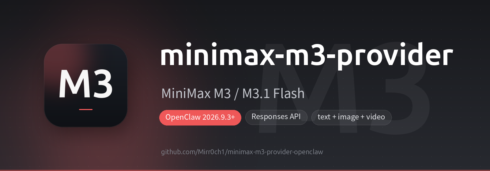

<p align="center">
  
</p>

<p align="center">
  <a href="https://clawhub.ai/mirr0ch1/plugins/minimax-m3-provider"></a>
  <a href="https://clawhub.ai/mirr0ch1/plugins/minimax-m3-provider"></a>
  
  
</p>

<p align="center">
     
</p>

<p align="center">
  <a href="https://clawhub.ai/mirr0ch1/plugins/minimax-m3-provider"></a>  
</p>

<h1 align="center">minimax-m3-provider</h1>

<p align="center">
  <b>OpenClaw 插件：以 OpenAI Responses 协议接入 MiniMax M3 / M3.1 Flash —— 聊天/文本 + 图片理解 + 视频理解</b><br>
  <sub>OpenClaw plugin: MiniMax M3 &amp; M3.1 Flash over the OpenAI Responses API — chat/text with reasoning-preserving replay, plus image and video understanding</sub>
</p>

---

## 简介 / Introduction

本插件把 **MiniMax M3** 注册为 OpenClaw 的 Provider,一个 provider id(`minimax-tp`)同时覆盖两条链路:

1. **聊天 / 文本** —— `api.registerProvider`,走 **OpenAI Responses 兼容端点**(`POST /v1/responses`)。
   推理内容(reasoning)在 Responses 协议里是一等 output item,转录会原生回传,多轮 thinking
   天然连续,无需任何请求体补丁。
2. **图片 / 视频理解** —— `api.registerMediaUnderstandingProvider`,用 Responses 的
   `input_image` / `input_video` content part 调用同一个端点。

This plugin registers **MiniMax M3** under a single provider id (`minimax-tp`) that serves two
extension surfaces: chat/text over the **OpenAI Responses** endpoint, and image/video
understanding via `input_image` / `input_video` content parts.

### 为什么用 Responses?/ Why Responses?

Responses 协议下,历史消息里的 `reasoning` item 会**原样回传给模型**(OpenClaw 的
`openai-compatible` replay family 不会丢弃它),因此跨轮次的思考链是连续的。Chat Completions
路线则要手工把 `reasoning_content` 塞回请求体,这正是本插件放弃它的原因。

---

## 特性 / Highlights

| | |
|---|---|
| 🧠 **原生推理回传** | `reasoning` 是一等 output item,多轮思考连续,不需要补丁 |
| 🖼️ **图片理解** | 走 `input_image`,`detail` 可配 low / default / high |
| 🎬 **视频理解** | 走 `input_video`,支持抽帧率(`fps` 0.2–5)与清晰度调节 |
| ⚡ **优先队列** | `serviceTier: "priority"` 开关(1.5 倍价,插队准入、更低延迟) |
| 💾 **提示缓存** | `promptCacheKey` 开关,透传 MiniMax `prompt_cache_key` |
| 🔌 **零配置默认** | 只填 API Key 即可用,默认 `https://api.minimax.cn/v1` |
| 🧩 **单插件双能力** | 聊天 + 媒体理解合并在一个插件里,不用装两个 |

---

## 安装 / Installation

### 方式一:ClawHub(推荐)/ via ClawHub

```bash
openclaw plugins search minimax-m3
openclaw plugins install clawhub:@mirr0ch1/minimax-m3-provider
systemctl --user restart openclaw-gateway   # 或 openclaw gateway restart
```

### 方式二:GitHub 仓库 / via GitHub

```bash
openclaw plugins install Mirr0ch1/minimax-m3-provider-openclaw
```

### 方式三:手动 / Manual

```bash
git clone https://github.com/Mirr0ch1/minimax-m3-provider-openclaw.git \
  ~/coding/minimax-m3-provider-openclaw
```

然后在 `~/.openclaw/openclaw.json` 中启用:

```json5
{
  plugins: {
    allow: ["minimax-m3-provider"],
    load: { paths: ["~/coding/minimax-m3-provider-openclaw"] },  // 或放进 ~/.openclaw/extensions/
    entries: {
      "minimax-m3-provider": { enabled: true },
    },
  },
}
```

### 写入 API Key

```bash
echo 'MINIMAX_TOKEN_PLAN_API_KEY=your-key-here' >> ~/.openclaw/.env
```

模型选择器读的是 `models.providers`(插件目录只负责动态发现),所以还要显式写一段:

```json5
{
  models: {
    providers: {
      "minimax-tp": {
        baseUrl: "https://api.minimax.cn/v1",
        apiKey: "${MINIMAX_TOKEN_PLAN_API_KEY}",
        api: "openai-responses",
        timeoutSeconds: 7200,
        models: [
          {
            id: "MiniMax-M3",
            name: "MiniMax-M3",
            api: "openai-responses",
            reasoning: true,
            input: ["text", "image", "video"],
            contextWindow: 1000000,
            maxTokens: 131072,
          },
          {
            id: "MiniMax-M3.1-Flash",
            name: "MiniMax-M3.1-Flash",
            api: "openai-responses",
            reasoning: true,
            input: ["text", "image", "video"],
            contextWindow: 1000000,
            maxTokens: 131072,
            compat: { supportedReasoningEfforts: ["low", "medium", "high", "xhigh", "max"] },
          },
        ],
      },
    },
  },
  agents: {
    defaults: {
      // 否则 agent 用不了(把要用到的模型都列上)
      modelPolicy: { allow: ["minimax-tp/MiniMax-M3", "minimax-tp/MiniMax-M3.1-Flash"] },
    },
  },
}
```

重启网关后验证:

```bash
openclaw plugins list | grep -i minimax
openclaw models list  | grep -i minimax
```

---

## 配置 / Configuration

插件配置位于 `plugins.entries["minimax-m3-provider"].config`(注意 key 是**插件 id**,不是 provider id):

```json5
{
  plugins: {
    entries: {
      "minimax-m3-provider": {
        enabled: true,
        config: {
          serviceTier: "priority",     // standard(默认) | priority
          promptCacheKey: "my-cache",  // 可选,透传 prompt_cache_key
        },
      },
    },
  },
}
```

| 选项 / Option | 类型 | 默认值 | 说明 / Description |
|---|---|---|---|
| `serviceTier` | `standard` \| `priority` | — | MiniMax `service_tier`。`priority` = 1.5 倍价,优先队列准入(更少失败、更低延迟)。 |
| `promptCacheKey` | string | — | 透传 MiniMax `prompt_cache_key`,用于提示缓存。 |

> 两个字段都只在**未显式设置**时注入,不会覆盖其它来源的取值。
> Both fields are injected only when absent, so they never clobber an explicit value.

### 媒体理解相关环境变量 / Media env vars

| 环境变量 | 默认值 | 说明 |
|---|---|---|
| `MINIMAX_TOKEN_PLAN_API_KEY` / `MINIMAX_API_KEY` | — | API 密钥(前者优先)。 |
| `MINIMAX_IMAGE_DETAIL` | `high` | `input_image.detail`:`low` \| `default` \| `high`。 |
| `MINIMAX_VIDEO_DETAIL` | `high` | `input_video.detail`:`low` \| `default` \| `high`。 |
| `MINIMAX_VIDEO_FPS` | `2` | 视频抽帧率,有效范围 0.2–5。 |

---

## 模型 / Models

| 模型 / Model | 输入 | 上下文 | 最大输出 | 推理 |
|---|---|---|---|---|
| `MiniMax-M3` | text + image + video | 1,000,000 | 131,072 | ✅ 开关式 |
| `MiniMax-M3.1-Flash` | text + image + video | 1,000,000 | 131,072 | ✅ 强度可调(low→max) |

> 🔁 **旧 id 兼容**:`MiniMax-M3.1-Flash-Preview`(以及任意大小写写法)由 manifest 的
> `modelIdNormalization` 别名自动归一为 `MiniMax-M3.1-Flash`,老配置无需改动即可继续用。

> 输出的上游硬上限是 524,288,这里取官方推荐值 131,072。视频/图片理解链路的
> `max_output_tokens` 固定为 2000(描述类任务足够,且避免思考把预算吃光)。
>
> `MiniMax-M3.1-Flash` 于 **2026-10-19 正式发布**(此前以 `-Preview` 后缀提供,旧 id 仍可解析),
> 已上 MiniMax API / M Plan / MiniMax Code。它**不是纯文本模型**:官方定位为 native
> multimodal,实测 text + image + video 输入全部可用(输出仅文本),因此输入声明为三者齐备。
> 上下文/输出上限沿用 M3 的同族取值(输出上游硬上限 524,288),如官方后续公布不同数字请按需调整。

---

## 思考等级 / Thinking Levels

### M3.1 Flash:真实档位,`low` → `max` 直通

M3.1 的 `reasoning` **始终开启**,`effort` 是真实强度旋钮
(`low` / `medium` / `high` / `xhigh` / `max`,省略时服务端默认 `max`),
且 `effort: "none"` / `ultra` 会直接返回 **HTTP 400**。因此该模型**不提供 `off` 档**。

OpenClaw 2026.10 起原生支持 `xhigh` / `max`(并由核心自动追加 `ultra`),
插件把 profile 声明为 `low` / `medium` / `high` / `xhigh` / `max`,默认 `max`,
各档 1:1 落到 MiniMax 的 `reasoning.effort`:

| 等级 / Level | `reasoning.effort` | 说明 |
|---|---|---|
| `low` | `low` | 直通 |
| `medium` | `medium` | 直通 |
| `high` | `high` | 直通(模型自己的中高档,**不再**压成 `max`) |
| `xhigh` | `xhigh` | 直通 |
| `max` | `max` | 直通,profile 默认档 |
| `ultra` | `max` | OpenClaw 的 harness 模式,核心会在进入 Provider 前降为 `max` |
| `off`(仅遗留会话状态) | `low` | 模型无法真正关闭思考,退化到最省档;不下发 `none` |
| `minimal` / `adaptive`(profile 不提供) | `low` / `medium` | 兜底映射,避免别的 Provider 的会话状态把非法值发到线上 |

> 为什么还要在插件里钉?OpenClaw 核心在 `off` 时会**不写 `reasoning` 字段** ——
> 那会被 M3.1 当成默认的 `max`;遗留的 `off` 会话则可能下发 `none`(HTTP 400)。
> 插件在请求体上显式映射,保证这两条边界路径不会打到线上。
>
> ⚠️ 旧版(≤1.2.1)只声明 `low` / `medium` / `high`,并把 `high` 钉成 `max`。
> 当 `agents.defaults.thinkingDefault` 为 `max` 时会提示"不支持 max,已回退到 high"。
> **1.3.0** 起 profile 覆盖到 `max`,`/think max` / `--thinking max` 不再回退。

### M3:开关式

`/think` 接受 `off` / `low` / `medium` / `high` / `xhigh` / `max`,默认 `high`:

| 等级 / Level | `reasoning.effort` | 效果 |
|---|---|---|
| `off` | `none` | 关闭思考 |
| `low` / `medium` / `high` / `xhigh` / `max` | 同名 effort | **M3 不区分强度,均只是"开启思考"** |

> ⚠️ **M3 的 effort 是开关而不是旋钮。** 实测 `max` / `xhigh` / `none` 都返回 200,
> 但非 `none` 的取值思考强度完全一致;这些档位的存在是为了跟 OpenClaw 的
> `low`…`max` 对齐,避免全局 `thinkingDefault: max` 在 M3 上触发降级提示。
>
> MiniMax M3 does not grade reasoning intensity: any non-`none` effort simply enables
> thinking. All enabled levels exist for OpenClaw level compatibility only.

---

## 媒体理解 / Media Understanding

注册为 `image` + `video` 双能力的媒体理解 Provider,`autoPriority` 为 `10`(高于
stepfun / minimax 兜底档),默认模型都是 `MiniMax-M3`。

| 能力 | content part | 支持格式 | 可调参数 |
|---|---|---|---|
| 图片 | `input_image` | JPEG / PNG / GIF / WEBP | `detail`(low / default / high) |
| 视频 | `input_video` | MP4 / AVI / MOV / MKV | `fps` 0.2–5、`detail` |

媒体理解的默认提示词(prompt)可在 `index.js` 的 `DEFAULT_PROMPT` 处修改:

```
请详细描述这个多媒体内容，包括所有可见信息（画面、动作、文字、场景等）。
```

> 媒体走的是 `resolveProviderHttpRequestConfig` + `postJsonRequest`,与聊天链路复用同一份
> baseUrl / 鉴权 / 网络策略(含私网与代理处理)。

---

## 实测行为 / Verified Behaviour

以下均为对着线上网关实测(2026-08/09),不是从文档抄的:

1. **端点** `POST https://api.minimax.cn/v1/responses`,鉴权 `Authorization: Bearer <token>`。
   中国大陆域名已从 `api.minimaxi.com` 迁到 **`api.minimax.cn`**;实测两域名并行可用、行为一致
   (旧域名未停服),本插件默认写死新域名。
2. **图片输入**用 data URL(`data:image/png;base64,...`),`detail` 三档均可。
3. **视频输入**用 data URL(`data:video/mp4;base64,...`),`fps` 实测 1–2 稳定
   (2026-10-19 用红/蓝双帧 MP4 复测,帧色按序答对)。
4. **历史可携带 `reasoning` item**,多轮思考链连续;这是本插件选 Responses 的核心理由。
5. **`reasoning.effort` 语义按模型不同**:M3 是开关(`none` 关闭,其余值只是"开启");
   M3.1 Flash 是强度旋钮(`low`→`max`,始终开启,`none` 与 `ultra` 均报 400)。
   **正式版(2026-10-19)对这些契约逐条复测,与 Preview 行为一致。**
6. **`service_tier: "priority"`** 被网关接受,走优先队列(计费 1.5 倍)。

---

## 故障排除 / Troubleshooting

| 现象 / Symptom | 原因与处理 / Cause & Fix |
|---|---|
| 模型列表里没有 `MiniMax-M3` / `MiniMax-M3.1-Flash` | 没解析到密钥,或没写 `models.providers.minimax-tp`。插件目录只负责动态发现,选择器读配置。 |
| `not allowed for agent ... by agents.defaults.modelPolicy.allow` | 把对应模型(`minimax-tp/...`)加进 `modelPolicy.allow`。 |
| `/think max` 在 M3.1 上提示"不支持,已回退到 high" | 插件版本需 ≥ **1.3.0**(该版本才把 `xhigh` / `max` 声明进 thinking profile);用 `openclaw plugins list` 确认加载的是新版本后重启网关。 |
| `/think off` 在 M3.1 上仍会思考 | 预期行为:M3.1 无法关闭思考,插件把它退化为 `effort: "low"`(最省),而不是下发会被 400 拒绝的 `none`。 |
| 改了 `baseUrl` 不生效 | `models.providers["minimax-tp"].baseUrl` 与插件默认值(写死在 `index.js`)是两处。 |
| 插件启用了但模型没出现 | 检查 `plugins.allow` 里是否有 `minimax-m3-provider`(是**插件 id**,不是 `minimax-tp`)。 |
| 媒体理解不走 M3 | 检查是否有更高 `autoPriority` 的视觉 Provider 抢占;M3 的优先级是 10。 |
| 重启网关后头几个请求失败 | 网关 warm-up 竞态,等约 20s 再试,不是插件问题。 |
| 配置里还写 `MiniMax-M3.1-Flash-Preview` 能用吗? | 能。manifest 的 `modelIdNormalization` 别名会在**解析阶段**归一为正式名,不用改配置。注意 `openclaw capability model inspect --model ...-Preview` 是精确字符串匹配,**会报 Model not found 属正常**,实际推理路径不受影响。 |
| **图片**理解报 401 `login fail ... API secret key`,但**视频**正常 | 见 v1.2.0 更新日志:核心图片分支不注入 auth。本插件已自兜底;若仍报错,说明 `MINIMAX_TOKEN_PLAN_API_KEY` 未进网关环境(见下方环境变量表)。 |

---

## 从旧插件 `minimax-m3` 迁移 / Migrating from `minimax-m3`

本插件的插件 id 已从 `minimax-m3` 规范化为 **`minimax-m3-provider`**(provider id `minimax-tp` 不变)。
老配置需要改 key:

```json5
{
  plugins: {
    // allow: ["minimax-m3"],                    // ← 旧 id,删掉
    allow: ["minimax-m3-provider"],               // ← 改成插件新 id
    entries: {
      // "minimax-m3": { enabled: false },       // ← 旧条目,删掉
      "minimax-m3-provider": { enabled: true },   // ← 换成新条目
    },
  },
}
```

`models.providers["minimax-tp"]`、`minimax-tp/MiniMax-M3` 等引用**完全不用动**。

> ⚠️ 先禁用/卸载旧插件再启用新插件:两者会注册同一个 provider id `minimax-tp`,同时加载会冲突。

---

## 更新日志 / Changelog

**v1.3.0**(2026-10-26)
- **跟进 OpenClaw 原生 `max` / `xhigh` 档位**:M3.1 Flash 的 thinking profile 从
  `low`/`medium`/`high` 扩到 `low`/`medium`/`high`/`xhigh`/`max`,默认 `max`。
  修复 `agents.defaults.thinkingDefault: "max"`(或 `--thinking max`)时被核心判为
  "不支持 max,已回退到 high" 的问题。`ultra` 仍由核心自动追加,进入 Provider 前降为 `max`。
- **映射改为 1:1**:`high` → `high`(不再钉成 `max`),`xhigh` → `xhigh`,
  `max` → `max`,`off`(遗留)→ `low`。M3.1 官方允许值实测为
  `low/medium/high/xhigh/max`,`ultra` 与 `none` 均返回 HTTP 400。
- **M3 同步暴露 `xhigh` / `max`**:M3 的 effort 仍只是开关,但这些值实测均返回 200,
  这样全局 `thinkingDefault: max` 在 M3 上也不会触发降级提示。
- 默认档位:M3.1 改为 `max`(与 MiniMax 省略 effort 时的默认值、以及旧版 `high→max`
  的实际效果一致);M3 保持 `high`。

**v1.2.1**(2026-10-19)
- **旧模型 id 继续可用**:manifest 增加 `modelIdNormalization.providers["minimax-tp"].aliases`,
  把 `minimax-m3.1-flash-preview` 映射到 `MiniMax-M3.1-Flash`。已装旧配置(模型注册名、`model.primary`、
  `imageModel`、`tools.media.*.preferredModel`、cron `payload.model` 里写的是 `-Preview`)会**在解析阶段
  自动归一**到正式名,无需改配置。这是核心的官方机制(Google / Anthropic 的 `*-preview` → GA 也用它),
  且大小写不敏感。

**v1.2.0**(2026-10-19)
- **修复图片理解链路 401**(`login fail ... API secret key`):OpenClaw 核心的
  `capability === "image"` 分支直接调用 `provider.describeImage(input)`,**没有**像
  audio / video 分支那样先走 `resolveProviderExecutionAuth` 并把 `...requestAuth` 注入,
  于是 `req.auth` / `req.apiKey` 都是空的,`req.cfg` 里只有被脱敏的 key。插件现在自己兜底
  解析(provider config 的 `\${ENV}` / `secretref-env:` → `MINIMAX_TOKEN_PLAN_API_KEY`
  → `MINIMAX_API_KEY`),并拒绝把带 `…` 的脱敏值发出去。**视频链路一直是好的**,因为它有 auth。
- 跟进 M3.1 Flash 正式版:**模型 id 收敛为 `MiniMax-M3.1-Flash`**(旧 id 的兼容见 v1.2.1)
- 文档纠正:该模型**不是纯文本模型**。2026-10-03 实测 + 正式版复测确认 text / image /
  video 输入全部可用,README 模型表的输入列与示例配置的 `input` 同步改为三者齐备
- 插件源码中"Flash Preview"字样清理(仅保留 `MiniMax-M3.1-*` 族匹配正则,新旧 id 通吃)
- 插件行为无需变更:`reasoning.effort` 映射(high→max、off→low)与 `none` 报 400 的
  契约正式版实测与 Preview 完全一致

**v1.1.0**(2026-09-28)
- 新增 `MiniMax-M3.1-Flash-Preview` 模型接入(文本输入,Responses API,Token Plan)
- 思考档位映射:该模型下 OpenClaw `high` → MiniMax `max`,由插件在 `wrapStreamFn` 钉入
- 思考档位按模型区分:M3.1 不提供 `off`(模型无法关闭思考,`effort:"none"` 会 400),
  `off` 退化到 `low`
- 该模型的 `max_output_tokens`/`contextWindow` 沿用 M3 同族取值

**v1.0.0**(2026-09-17)
- 项目规范化改名为 `minimax-m3-provider-openclaw`,插件 id 从 `minimax-m3` 改为 `minimax-m3-provider`
- 首次发布到 ClawHub(`@mirr0ch1/minimax-m3-provider`)与 GitHub
- 合并了旧插件 `minimax-m3-thinking-fix` 与 `minimax-video-understand` 的能力:
  一个插件同时注册 chat provider 与 image/video 媒体理解 Provider
- 中国大陆端点已迁移到 `api.minimax.cn`

---

## 开发 / Development

```bash
git clone https://github.com/Mirr0ch1/minimax-m3-provider-openclaw.git
cd minimax-m3-provider-openclaw
```

目录结构 / Layout:

```
├── index.js                 # 聊天 provider + 媒体理解 provider + Responses 调用
├── openclaw.plugin.json     # manifest:contracts、configSchema、媒体理解元数据
├── package.json
└── README.md
```

把仓库路径加进 `plugins.load.paths` 即可热改热调,无需反复拷贝。

---

## 许可 / License

[MIT](LICENSE)
